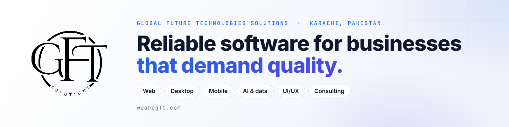

<picture>
  <source media="(prefers-color-scheme: dark)" srcset="./assets/banner-dark.png" />
  
</picture>

# GFT Solutions

**Global Future Technologies Solutions** is a registered software company in Karachi, Pakistan, founded in 2023. We design and build web, desktop and mobile applications and AI solutions, mostly for B2B clients.

[wearegft.com](https://www.wearegft.com) · [info@wearegft.com](mailto:info@wearegft.com) · Founder & CEO: [Yousuf Naveed Khan](https://yousufnaveedkhan.com)

## What we build

| Area | What it covers |
| --- | --- |
| **Web applications and websites** | Custom full-stack applications, corporate and e-commerce sites, WordPress and Shopify where they are the right tool |
| **Desktop software** | POS, billing, inventory and accounting, with role-based access and encrypted backups |
| **Mobile apps** | Cross-platform apps for Android and iOS, with backend and API integration |
| **AI and data solutions** | AI-assisted workflows, data cleaning and dashboards, with DataLinkk AI as our data and AI partner |
| **UI/UX and brand design** | Product and web design, design systems, logos and brand identity |
| **Software consulting** | Architecture planning, technology selection, code and design reviews |

## How we work

1. **Discover.** We start with your business, not a feature list: who uses the system, what goes wrong today, and what "done" means.
2. **Architect.** Structure before code. A clear plan for data, permissions and growth, so the system survives its second year, not just the demo.
3. **Deliver.** We build in visible steps, test with real users, hand over with documentation, and support you afterwards.

## Selected work

- **OptiCore**: our own Windows desktop POS, inventory and accounting software for optical shops. In testing, with a launch targeted for early 2027.
- **Financial Management System**: a desktop system for income and expenses, accounts, budgets and invoices.
- **ConvoConnect**: a real-time chat and team communication platform with channels and file sharing.
- **JazzCash MWallet plugin for WooCommerce**: adds JazzCash as a payment method for WordPress stores.
- **KirayaNaama**: rental management with a Flutter mobile app and a Laravel administration portal.
- **Labour Connect**: a bidding and labour-management platform with job posting and admin controls.

Many of our engagements are confidential, so this list is only a small part of what we deliver.

## Technologies

Node.js, React, Flutter, React Native, Laravel and PHP, .NET, WordPress, WooCommerce, Shopify, PostgreSQL and SQL Server.

## Partners

DataLinkk AI is our data and AI partner, and Starteq is our engineering partner.

## Get in touch

Tell us about your business and what you want to build.

- Website: [wearegft.com](https://www.wearegft.com)
- Email: [info@wearegft.com](mailto:info@wearegft.com)
- LinkedIn: [GFT Solutions](https://www.linkedin.com/company/gftsolutionsofficial)
- Instagram: [@gftsolutionsofficial](https://www.instagram.com/gftsolutionsofficial/)
- Facebook: [gftsolutionsofficial](https://www.facebook.com/gftsolutionsofficial)
- Patreon: [behind-the-scenes updates](https://www.patreon.com/gftsolutionsofficial)
- Location: Karachi, Pakistan
